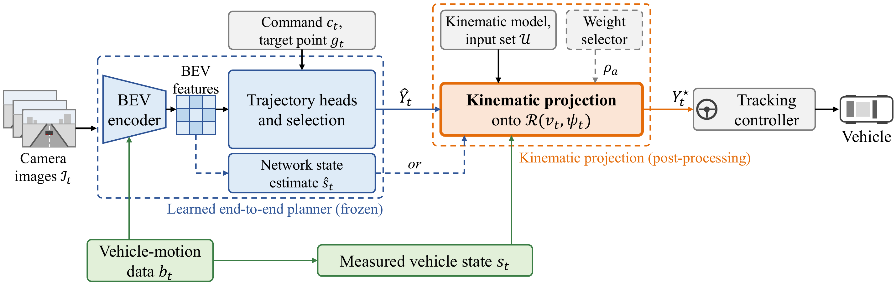

<div align="center">

# Kinematic Projection of Learned Trajectory Plans

**Conditions for Improving Planning and Execution Accuracy**

[](LICENSE)


</div>

<p align="center">
  
</p>

## Overview

Learned end-to-end planners often output plans that start at a speed the vehicle
cannot reach from its current state. We project each plan of a frozen planner onto
the reachable set of a kinematic vehicle model, starting from the current vehicle
state, and analyze when this projection improves the plan and the motion executed
by a tracking controller.

- **Diagnosis.** The planning error is mainly along the path and comes from an
  inconsistent initial speed; the projection removes this part.
- **Conditions.** The gain depends on the accuracy of the state, on how well the
  recorded motion fits the vehicle model, and on the rate weights; a run-time selector
  chooses the weight per window.
- **Execution.** Plans are driven by the same controller on a dynamic vehicle model,
  so the projection is evaluated on the executed motion.

## Main Results

Planning error (m) on the held-out scenes, projection from the measured state with
cross-validated weights:

| Planner | Learned plan | Projected | Change |
|---|:-:|:-:|:-:|
| No-cell (baseline) | 0.3299 | 0.2476 | −25% |
| 15-cell | 0.2857 | 0.2216 | −22% |
| 105-cell | 0.2793 | **0.2062** | **−26%** |

Controller-in-the-loop evaluation (105-cell planner):

| Reference | Executed error (m) | Tracking RMS (m) | Jerk RMS (m/s³) |
|---|:-:|:-:|:-:|
| Learned plan | 0.227 | 0.086 | 0.48 |
| Projected | 0.204 | **0.034** | 0.16 |
| Projected + selector | **0.190** | 0.038 | 0.23 |

## Installation

```bash
git clone https://github.com/gyuz1/E2E_AD_cell-planner.git
cd E2E_AD_cell-planner
pip install -r requirements.txt
```

All scripts run on the CPU.

## Data

Experiments use the ETRI E2E Driving Dataset (376 scenes, split by scene into 301
training and 75 held-out scenes). The scripts read the outputs of a trained planner
on these scenes, stored as `.npz` with the fields

| Field | Content |
|---|---|
| `pred` | learned plan, 6 waypoints × (x, y) |
| `gt` | recorded future positions |
| `ego_lcf` | measured vehicle state |
| `state_pred` | state estimated by the network |
| `mode`, `scene`, `frame` | command, scene and frame index |

## Usage

```bash
# planning error and cross-validated weights (run first)
python analysis/final_tables.py <heldout.npz> cell105

# error decomposition and transmission of state errors
python analysis/deep_analysis.py <heldout.npz> <train.npz> cell105

# controller-in-the-loop evaluation
python analysis/closedloop_sim.py <heldout.npz> cell105

# run-time weight selector
python analysis/selector_cv.py <heldout.npz> cell105
```

`cell105`, `cell15` and `nocell` select the planner. Results are written to
`analysis/results/` and figures to `figures/`. The results reported in the paper
are included in [`analysis/results/`](analysis/results).

| Paper | Script |
|---|---|
| Table 1 | `final_tables.py`, `weight_cv.py` |
| Table 2 | `deep_analysis.py`, `split_terms.py` |
| Table 3 | `split_terms.py` |
| Table 4 | `weight_vs_noise.py` |
| Table 5 | `selector_cv.py` |
| Table 6 | `closedloop_sim.py`, `stats_extra.py`, `selector_closedloop.py` |
| Table 7 | `locked_test.py`, `locked_repeat.py` |
| Fig. 4 – 7 | `plot_consistency_b.py`, `plot_qualitative.py`, `plot_tradeoff.py`, `plot_closedloop.py` |

The projection solver is in [`analysis/fast_projection.py`](analysis/fast_projection.py).

## Citation

```bibtex
@article{kinematicprojection2026,
  title   = {Kinematic Projection of Learned Trajectory Plans: Conditions for Improving Planning and Execution Accuracy},
  journal = {International Journal of Control, Automation, and Systems},
  year    = {2026}
}
```

## Acknowledgement

The learned planners are built on [VAD](https://github.com/hustvl/VAD) and
[LAW](https://github.com/BraveGroup/LAW). We thank the authors for releasing their code.

## License

This project is released under the [Apache 2.0 license](LICENSE).
