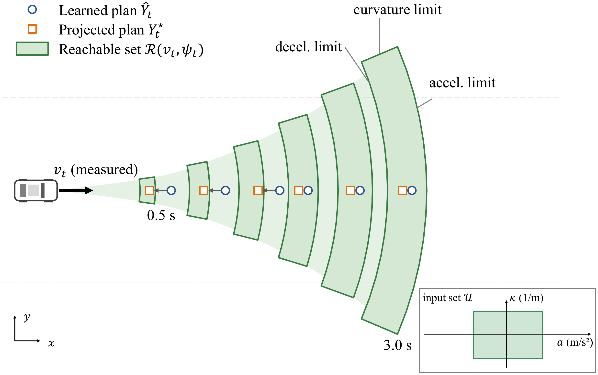
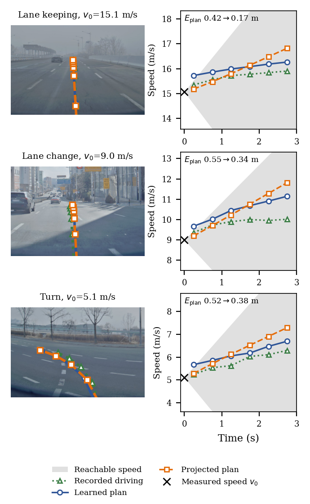
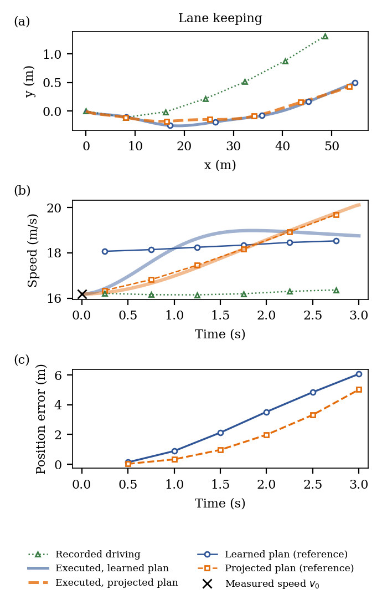
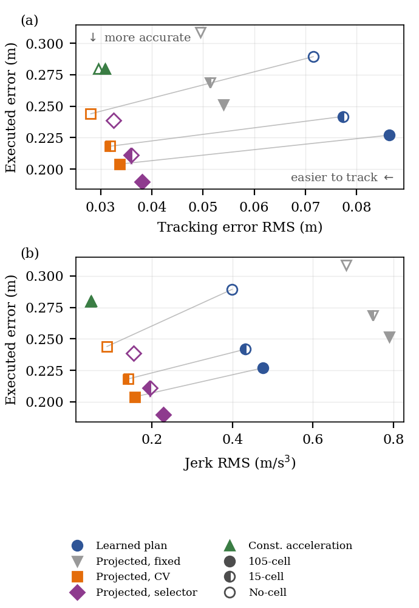

<div align="center">
<h1>Kinematic Projection</h1>
<h3>Kinematic Projection of Learned Trajectory Plans: Conditions for Improving Planning and Execution Accuracy</h3>

[](LICENSE)&nbsp;
&nbsp;


</div>

## News
* **` Nov. 2026`:** We release the projection solver, the analysis scripts and all measured results of the paper.

## Table of Contents
- [Introduction](#introduction)
- [Qualitative Results](#qualitative-results)
- [Main Results](#main-results)
- [Getting Started](#getting-started)
- [Acknowledgement](#acknowledgement)
- [Citation](#citation)

## Introduction
Learned end-to-end planners predict future waypoints directly from sensor data, but their
plans often start at a speed that the vehicle cannot reach from its current state. We place
a kinematic projection between a frozen learned planner and the tracking controller: each
plan is mapped onto the set of trajectories that a kinematic vehicle model can realize from
the current speed and course angle, under bounds on acceleration and curvature. Instead of
proposing a new planner, we study **when this projection helps and when it hurts**. With the
measured vehicle state, the projection reduces the planning error of three learned planners
by 22–26% and the error of the executed motion by 10–16%; under scene cross-validation, a run-time weight selector lowers
both further. Most of the gain comes from correcting the speed along the path, and it shrinks
when the planner's own state estimate is used instead of the measured state.

<div align="center"><b>Overview. The frozen planner's plan is projected onto the reachable set of a kinematic vehicle model before it is passed to the tracking controller.</b>

<b>Reachable set. The learned plan starts faster than the vehicle can reach; the projection moves its waypoints into the set.</b>

</div>

## Qualitative Results
<div align="center">
<b>Learned plan, projected plan and recorded driving on held-out scenes: lane keeping, lane change and turn.</b>

<b>The same window driven by the same controller with the learned plan and with the projected plan.</b>

</div>

## Main Results

> Planning error E<sub>plan</sub> (m) on 75 held-out scenes, projection from the measured state with cross-validated weights

| Planner | Learned plan | Projected | Change |
| :---: | :---: | :---: | :---: |
| No-cell (baseline) | 0.330 | 0.248 | −25% |
| 15-cell | 0.286 | 0.222 | −22% |
| 105-cell | 0.279 | **0.206** | **−26%** |

> Controller-in-the-loop evaluation, 105-cell planner

| Reference | Executed error (m) | Tracking RMS (m) | Jerk RMS (m/s³) |
| :---: | :---: | :---: | :---: |
| Learned plan | 0.227 | 0.086 | 0.48 |
| Projected | 0.204 | **0.034** | **0.16** |
| Projected + selector | **0.190** | 0.038 | 0.23 |

<div align="center">
<b>Easier tracking does not imply a more accurate executed motion; only the cross-validated projection and the selector improve both.</b>

</div>

All numbers of the paper are stored in [`analysis/results/`](analysis/results).

## Getting Started

**Installation**
```bash
git clone https://github.com/gyuz1/E2E_AD_cell-planner.git
cd E2E_AD_cell-planner
pip install -r requirements.txt
```

**Data.** Experiments use the ETRI E2E Driving Dataset (376 scenes, split by scene into 301
training and 75 held-out scenes). The scripts read the outputs of a trained planner on these
scenes as `.npz` files with the fields `pred` (learned plan, 6 × 2), `gt` (recorded future
positions), `ego_lcf` (measured state), `state_pred` (network-estimated state), `mode`
(command), `scene` and `frame`.

**Evaluation**
```bash
# planning error and cross-validated weights (run first)
python analysis/final_tables.py <heldout.npz> cell105
# error decomposition and transmission of state errors
python analysis/deep_analysis.py <heldout.npz> <train.npz> cell105
# controller-in-the-loop evaluation
python analysis/closedloop_sim.py <heldout.npz> cell105
# run-time weight selector
python analysis/selector_cv.py <heldout.npz> cell105
```
`cell105`, `cell15` and `nocell` select the planner. The projection solver is
[`analysis/fast_projection.py`](analysis/fast_projection.py).

| Paper | Script |
| :---: | :--- |
| Table 1 | `final_tables.py`, `weight_cv.py` |
| Table 2 | `deep_analysis.py`, `split_terms.py` |
| Table 3 | `split_terms.py` |
| Table 4 | `weight_vs_noise.py` |
| Table 5 | `selector_cv.py` |
| Table 6 | `closedloop_sim.py`, `stats_extra.py`, `selector_closedloop.py` |
| Table 7 | `locked_test.py`, `locked_repeat.py` |
| Fig. 4–7 | `plot_consistency_b.py`, `plot_qualitative.py`, `plot_tradeoff.py`, `plot_closedloop.py` |

## Acknowledgement
The learned planners in this work are built on [VAD](https://github.com/hustvl/VAD) and
[LAW](https://github.com/BraveGroup/LAW). We thank the authors for releasing their code.

## Citation
If you find this work useful, please cite:

```bibtex
@article{kinematicprojection2026,
  title   = {Kinematic Projection of Learned Trajectory Plans: Conditions for Improving Planning and Execution Accuracy},
  journal = {International Journal of Control, Automation, and Systems},
  year    = {2026}
}
```
